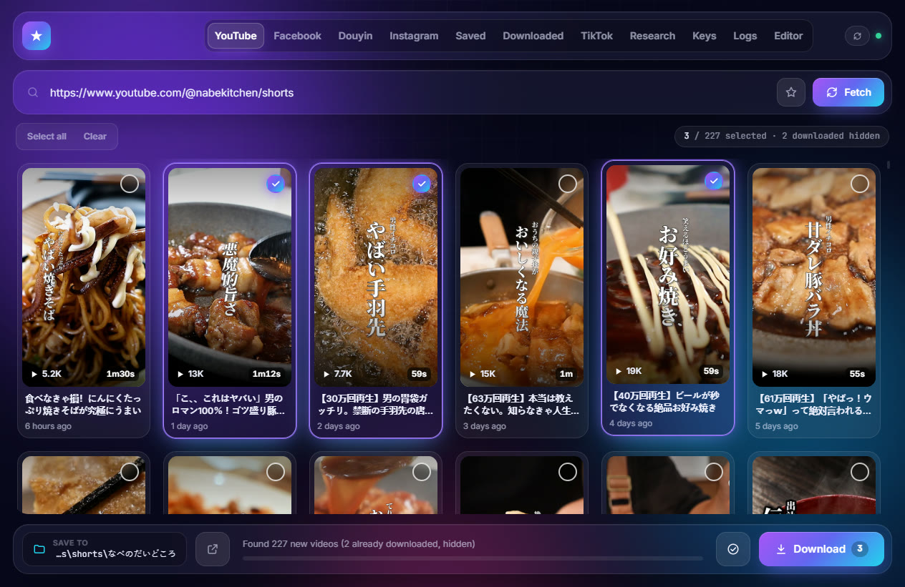
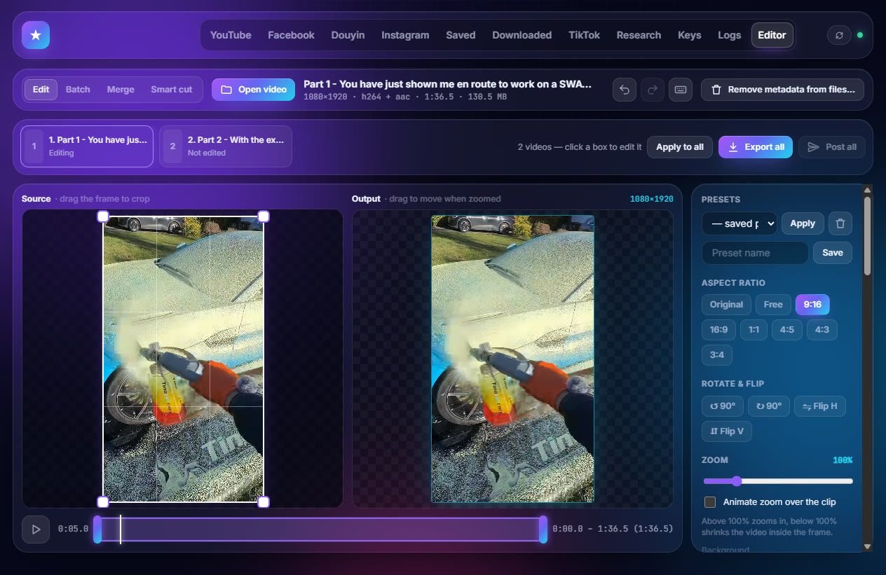
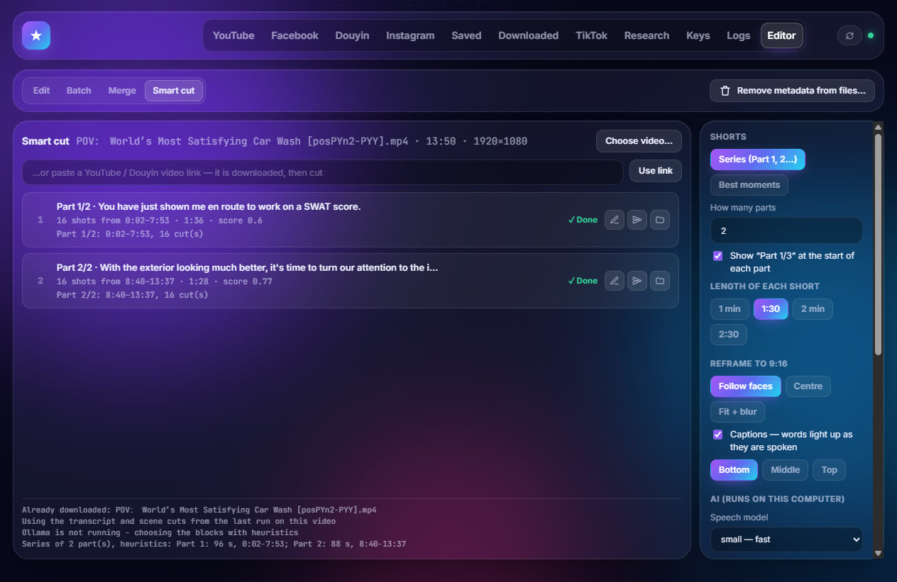
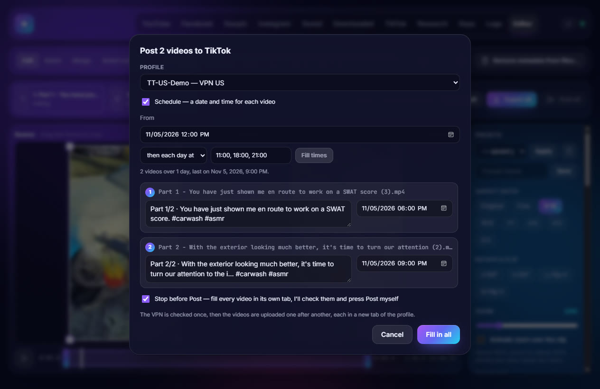
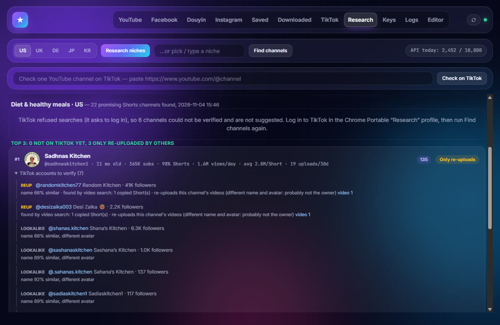

# Grabber

Windows desktop app for short-form video work: list and batch-download Shorts / Reels from YouTube, Facebook, Douyin and Instagram, edit them, cut long videos into vertical shorts with local AI, and post them to TikTok on a schedule — plus a research tool that finds YouTube Shorts channels that are not on TikTok yet.

Requires **Windows 10/11 (64-bit)** and an internet connection.



## What it does

- **Download** — paste a channel / page / profile link, see every video with views, length and how long ago it was posted, pick and download.
- **Edit** — crop, zoom, color, text, logo, music, speed… one video or a queue of several, with presets, batch and merge.
- **Smart cut** — turn a long 16:9 video (a file or a YouTube / Douyin link) into a 9:16 series *Part 1, Part 2…* or the best moments, never cut mid-sentence, with word-by-word captions. Runs on your computer.
- **Post to TikTok** — one video or many at once, each with its own caption and schedule (e.g. every day at 11:00, 18:00 and 21:00), through Chrome Portable profiles with a VPN check.
- **Research** — score hot niches, find young fast-growing Shorts channels and check whether they are already on TikTok.

## Supported sources

| Platform | What to paste | Notes |
|---|---|---|
| **YouTube Shorts** | Channel URL, e.g. `https://www.youtube.com/@channel/shorts` | Uses [yt-dlp](https://github.com/yt-dlp/yt-dlp) |
| **Facebook Reels** | Page URL, e.g. `https://www.facebook.com/page/reels` | Sign in to Facebook inside the app |
| **Douyin** | User URL, e.g. `https://www.douyin.com/user/MS4wLjABAAAA...` | Guests see ~20 latest videos; sign in for the full list |
| **Instagram Reels** | Profile URL, e.g. `https://www.instagram.com/username/reels/` | Guests see ~12 latest reels; sign in for the full list. Saved in 1080p when available |

Each card shows the views (likes on Douyin), the **length** (`1m30s`, `59s`, `17m20s`) and the **upload time** (`6 hours ago`, `3 days ago`; hover for the exact date):

| Platform | Where length and upload time come from |
|---|---|
| YouTube | The Shorts tab has neither: with a YouTube API key (the one used by Research) the whole list is filled at once (`videos.list`, 1 unit per 50 videos); without a key, each visible card is looked up with yt-dlp. |
| Douyin | Part of the list. |
| Instagram, Facebook | Read from each reel's page for the visible cards, together with the caption. |

Filenames follow the video title or caption. Videos already downloaded (or marked **Add to downloaded**) are hidden on the next fetch.

- **Saved** — the ★ button next to Fetch keeps a channel link for later.
- **Downloaded** — every downloaded video, with the TikTok profiles it was posted to. Select several to **Edit selected** (opens them in the editor queue) or **Post selected**.

## Editor



- **Edit** — aspect-ratio or free crop, zoom (including motion zoom), rotate/flip, trim, color + built-in filters, speed, volume, background music, fade, text + logo overlays, strip metadata; undo/redo and keyboard shortcuts (see the keyboard button on the Editor bar).
- **Queue** — open several videos at once (drop them on the window, or *Edit selected* in Downloaded). Each box keeps its own edits; **Apply to all** copies the current edits to the others (trims stay per video), **Export all** exports them one after another and **Post all** sends the exported files to TikTok.
- **Batch** — save an edit as a preset and apply it to many videos.
- **Merge** — combine clips into one video (blurred background, letterbox, or crop; crossfade).
- **Smart cut** — see below.
- Drag-and-drop video, music, or a logo image onto the window.
- Sources above 4K (e.g. 4320×5760 AV1) are exported scaled down to fit 4K, since H.264 encoders stop there.
- When the app is minimized, finished downloads and exports show a Windows toast.

## Smart cut (long video → vertical shorts)



Owner edition. In **Editor → Smart cut**, choose a video file or paste a **YouTube or Douyin video link** — the video is downloaded into `<download folder>\Smart cut\` (reused next time) and then cut. The clips are saved in a `<video> - smart cut` folder next to it; **Open all in Editor** or **Post all to TikTok** continues from there.

1. **Speech** — the audio is transcribed with [faster-whisper](https://github.com/SYSTRAN/faster-whisper) (`small`, `medium` or `large-v3-turbo`), with word timestamps. Transcript, scene cuts and motion are cached per video, so a second run is fast.
2. **Choosing what to keep**
   - **Series (Part 1, 2…)** — the important blocks of the whole video in story order, split into N parts of about the chosen length (1 min – 2:30). Sentences are joined into whole thoughts that are never cut, so a part never stops mid-sentence and the next one never starts with its end. Parts are split where the story pauses (a silence, a scene change, a finished thought). Talk-heavy videos weigh the words; footage (ASMR, cooking, gameplay) weighs motion and sound. A **Part 1/3** badge opens each part.
   - **Best moments** — N separate continuous moments, each 15 s – 2 min.
   - With [Ollama](https://ollama.com) running and the model pulled (`ollama pull qwen2.5:7b`), a local LLM marks the important and filler sentences and writes a caption per part (best moments: picks the hooks). Without it, the same choice is made with heuristics.
3. **Reframe to 9:16** — *Follow faces* (YuNet face detection with a steady, smoothed crop that jumps at scene cuts; centre crop when nobody is on screen), *Centre*, or *Fit + blur* (the whole frame on a blurred background, for slides and screen recordings). Black bars in the source are removed first.
4. **Captions** — burned-in, a few words at a time, each word lighting up as it is spoken; bottom, middle or top.

Whisper uses an NVIDIA GPU when CUDA 12 / cuDNN 9 are available (for example `pip install nvidia-cublas-cu12 nvidia-cudnn-cu12` into `.venv`) and falls back to the CPU otherwise. Models are downloaded on first use into the user data folder.

## Post to TikTok



Post to your TikTok channels, each logged in inside its own profile of **Google Chrome Portable** (with its own VPN extension).

1. Open the **TikTok** tab and choose your `GoogleChromePortable` folder — its profiles are listed (from `Data\profile\Local State`).
2. For each profile, set the country its VPN must show (guessed from names like `TT-JP-Leather`), or *No VPN check*.
3. Post:
   - **One video** — the ✈ button in Downloaded, Batch, Merge or the editor: pick the profile, edit the caption, optionally **Schedule** (5-minute steps, at least 15 minutes from now, up to about 30 days ahead).
   - **Several videos** — *Post selected* in Downloaded, *Post all* in the editor queue or Smart cut: one caption and one time per video. Spread the times *every N minutes/hours* from a start time, or *each day at* fixed times (e.g. `11:00, 18:00, 21:00`) — 30 videos then fill 10 days. The VPN is checked once, then each video is uploaded in its own tab.

Grabber starts Chrome Portable with a local remote-debugging port, opens the profile, waits until the exit IP is in the chosen country, then fills TikTok Studio's upload page and presses Post — or stops before Post when *Stop before Post* is ticked, so you can check each tab yourself. Chrome stays open for the next post. **Close every Chrome Portable window before the first post** — a Chrome started without the debugging port cannot be controlled. Posts are logged in `tiktok_posts.json`.

Automating uploads may be against TikTok's terms; you are responsible for the accounts you use.

## Research (niches → channels → TikTok check)



Finds promising YouTube Shorts channels in a hot niche that are **not on TikTok yet**. Owner edition. Needs a free YouTube Data API v3 key (Google Cloud Console → enable *YouTube Data API v3* → Credentials → Create API key): paste it in the box at the top of the **Research** tab — it is checked with one API call and kept in the app settings. Click the *API today* chip to change it later. (A `YOUTUBE_API_KEY=` line in a git-ignored `.env` file next to the app also works.)

1. Pick a market (US / UK / DE / JP / KR) and press **Research niches**: 10 niches from a built-in list of 40 are scored by the view velocity of their most-viewed Shorts of the last 14 days, the share of young channels and the number of 100K+ Shorts (scores are kept 24 h, so pressing again scores the next 10). Or type your own niche.
2. **Find channels**: Shorts channels found by the niche keywords, its most used hashtags and channel-name searches, kept when created in the last 36 months, 2K–1M subscribers, ≥ 60 % Shorts, active in the last 45 days, mostly in the market's language and about the niche; ranked by views/day, recent views and upload pace.
3. Up to 25 candidates are checked on TikTok in the Chrome Portable **Research** profile, by typing into TikTok's own search box: TikTok links and `@handles` written on the YouTube channel, handle variants, a user search by name (avatar compared by perceptual hash), a video search by Short titles, and every account found is opened (bio link back to YouTube, avatar, its latest videos compared frame by frame with the Shorts).
4. The run stops once 5 channels are free; each channel shows a verdict — **On TikTok**, **Likely on TikTok**, **Check suspects**, **Only re-uploads** (others repost it, the owner is not there), **Not on TikTok** — with every account found, its evidence and links to verify by hand.


If TikTok refuses searches (it asks to log in), channels with no account found are marked **Not verified** instead of *Not on TikTok* and are not suggested: log in to TikTok in the **Research** profile and run again. **Check on TikTok** runs step 3 for a single YouTube channel link. If TikTok shows a captcha, solve it in the Chrome window; the run waits.

## Editions and license activation

`edition.py` picks the build: **owner** (branch `main`: every feature, never locked, plus Research, Smart cut and a **Keys** tab that makes license keys) or **commercial** (branch `commercial`: no Research, no Smart cut, no key generator, locked until activated). New features land on `main`; merge `main` into `commercial` to ship the ones meant for customers.

The commercial app is locked until it is activated with a key made for that computer:

1. The buyer opens Grabber and sends you the **Machine ID** shown on the activation screen (with the payment).
2. You make the key in the **Keys** tab of the owner app (or `tools\keygen.bat` / `python tools/keygen.py issue <MACHINE-ID> --note "name"`): the key is printed, copied to the clipboard and listed in `%USERPROFILE%\.grabber-keygen\issued.csv`.
3. The buyer pastes the key → activated. The key only works on that machine (Ed25519-signed Machine ID + issue date), so sharing it does nothing. Lifetime by default; `--days N` makes a key that expires, `--minutes N` a short test or trial key.

The signing key is `%USERPROFILE%\.grabber-keygen\private.key` — **outside the repo, back it up and never share it**. `python tools/keygen.py init` creates it once and prints the public key embedded in `license.py`. `tools/` is not bundled into the exe. A reinstall of Windows changes the Machine ID: issue a new key.

## Logs

The **Logs** tab records fetches, downloads, exports, Smart cut runs, Research and every TikTok posting step (with error details) in `logs.jsonl`, filterable by source or errors only.

## Install (new machine)

1. Clone this repository.
2. Double-click **`setup.bat`**. It will:
   - install Python 3.12 via winget if Python 3.10–3.13 is missing
   - create `.venv` and install `requirements.txt` (includes faster-whisper and OpenCV for Smart cut)
   - install Chromium for Facebook / Douyin / Instagram
   - download a portable ffmpeg (LGPL) into `bin\`
   - install the Microsoft Edge WebView2 runtime if needed
   - create a **Grabber** shortcut on the Desktop
3. Open **Grabber** from the Desktop (or run `run.bat`).

Re-run `setup.bat` anytime to repair or update. Optional, for Smart cut: [Ollama](https://ollama.com) with `ollama pull qwen2.5:7b`, and the NVIDIA CUDA packages above for a GPU.

## User data

Stored under `%USERPROFILE%\.yt-shorts-downloader\` (not in this repo):

`settings.json`, `saved.json`, `downloaded.json`, `edit_presets.json`, `tiktok_posts.json`, `logs.jsonl`, Facebook / Douyin / Instagram login sessions, the in-app yt-dlp engine update, Smart cut models (`models\`) and analysis cache (`smartcut_cache\`).

## Build a `.exe` (optional)

```bat
.venv\Scripts\python -m pip install pyinstaller
.venv\Scripts\python build.py
```

Output is `dist\Grabber\` (includes ffmpeg if `bin\` is present, and faster-whisper / CTranslate2 when installed). The Desktop shortcut then points at the exe.

```bat
.venv\Scripts\python build.py --no-shortcut
```

## Layout

| Path | Role |
|---|---|
| `app.py` | Backend and pywebview window |
| `editor.py` | ffmpeg pipeline (crop, color, text/logo, music, presets, merge) |
| `smartcut.py` | Smart cut: transcription, scene/motion scan, series and moment picking, face-following reframe, captions, render |
| `web/` | UI (`app.js` = sources, Downloaded, TikTok; `editor.js` = Edit + queue; `batch.js` = Batch/Merge; `smartcut.js`; `research.js`; `keys.js`) |
| `facebook.py` / `douyin.py` / `instagram.py` | Listing videos with Playwright |
| `tiktok.py` | Posting through Chrome Portable profiles (CDP) |
| `research.py` | Niche scoring, Shorts channel search and TikTok existence check |
| `license.py` / `ed25519.py` | Machine ID and license key check (pure-Python Ed25519) |
| `edition.py` | owner / commercial build switch |
| `keygen.py`, `tools/keygen.py` | Seller-only license key generator (Keys tab + command line) |
| `engine.py` | Update yt-dlp from PyPI from inside the app |
| `build.py` | Package the `.exe` with PyInstaller |
| `tools/make_icon.py` | Regenerate the icon (needs Pillow) |
| `docs/images/` | Screenshots used in this README |

## Disclaimer

Use this tool only with content you own or have permission to download. Respect YouTube, Facebook, Douyin, Instagram and TikTok terms of service and applicable copyright law. This project is provided as-is for personal use.
